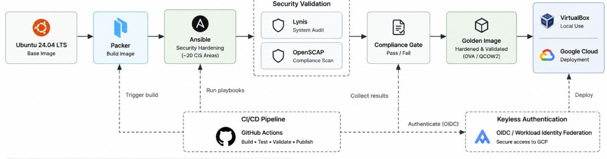
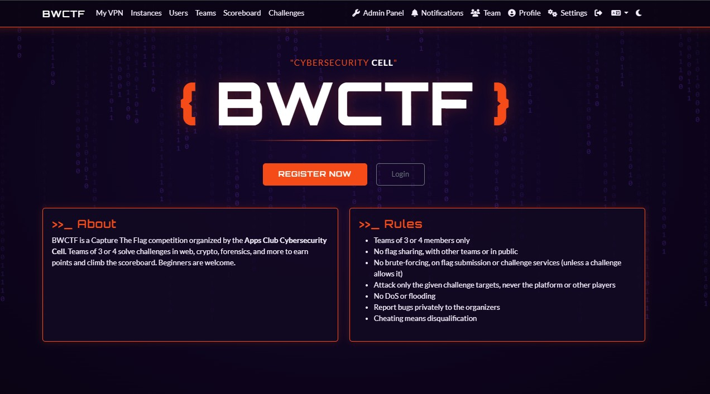
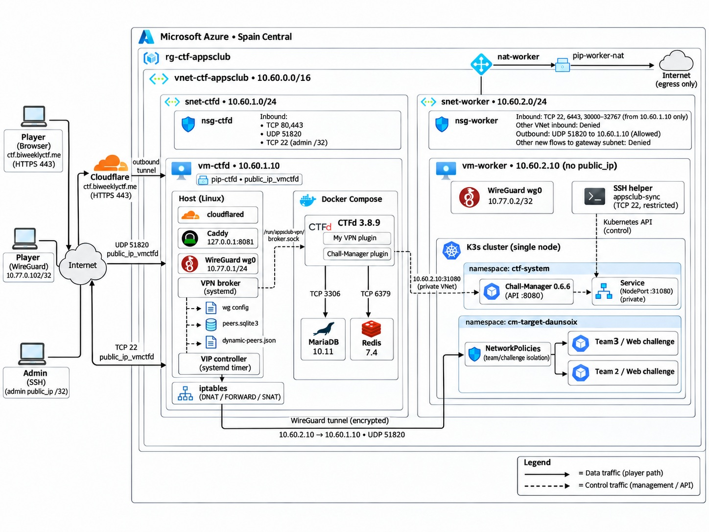
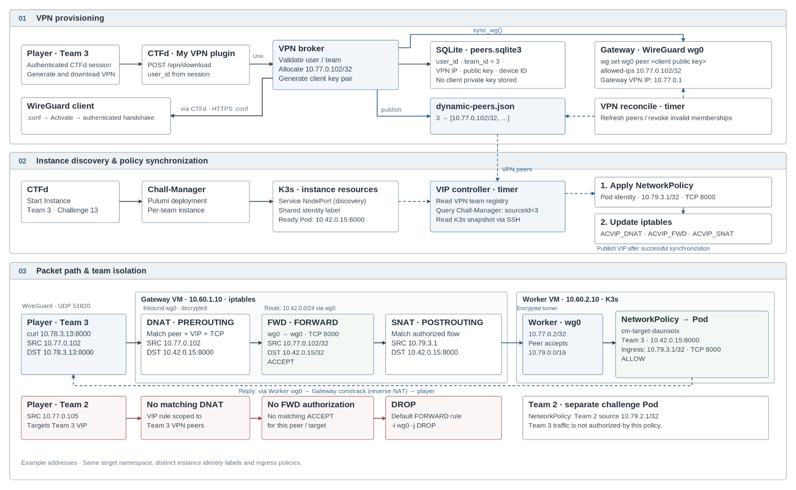
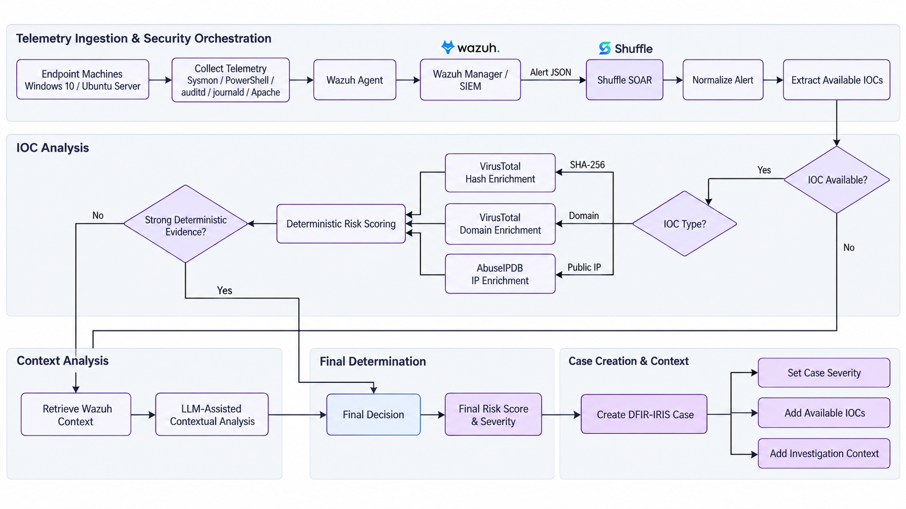

# Yasser Kouider — Cybersecurity Engineering

Final-year cybersecurity engineering student at ENSA Agadir. I focus on secure infrastructure, automated compliance, DevSecOps, SOC and hands-on security assessment.

[Portfolio](https://yasserkdr1.github.io/) · [LinkedIn](https://www.linkedin.com/in/yasser-kouider-b58864371)

## Featured projects

### [Golden Image Factory](https://github.com/Yasserkdr1/golden-image_factory)
Automated Ubuntu 24.04 image builds, CIS-aligned hardening, Lynis/OpenSCAP validation and a CI/CD compliance gate using Packer, Ansible and GitHub Actions.

### [BWCTF — Apps Club Cloud CTF](https://github.com/Yasserkdr1/ctf-appsclub-infra)
Azure CTF infrastructure with Terraform/Ansible, CTFd, K3s, Chall-Manager, Go/Pulumi, WireGuard and team-scoped network isolation.

Azure infrastructure and team isolation

### [AI-Assisted SOC Investigation Lab](https://github.com/Yasserkdr1/Automated-soc-investigation-lab)
Wazuh, Shuffle SOAR, threat intelligence, deterministic risk scoring, LLM-assisted context and DFIR-IRIS case management.

## Additional security work

- [Offensive Security Write-ups](https://github.com/Yasserkdr1/offensive-security-writeups) — three authorized lab assessments: Ignite, Apache CGI and Log4Shell; impact, detection and remediation.
- [SOC Investigation Write-ups](https://github.com/Yasserkdr1/Soc-Investigation-Writeups) — SIEM/EDR triage, DFIR and MITRE ATT&CK.
- [Multi-Signal Web Shell Detection](https://github.com/Yasserkdr1/Wazuh-Multi-Signal-Web-Shell-Detection) — Wazuh, Auditd and FIM correlation.
- [CyberThreat Analytics](https://github.com/Yasserkdr1/CyberThreat-Analytics-Pipeline) — streaming analytics and monitoring.

Open to a six-month cybersecurity internship starting February 2027.
